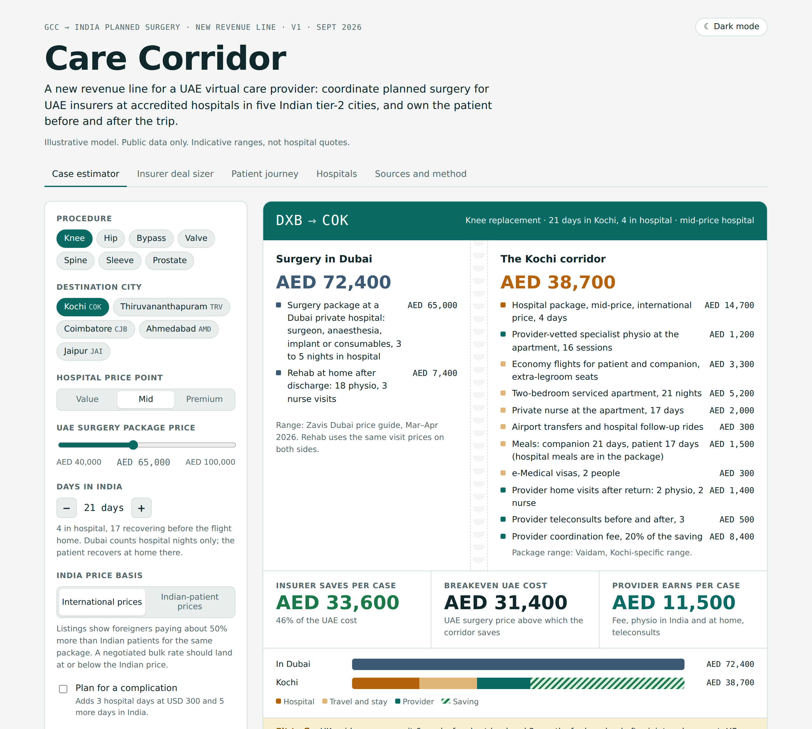
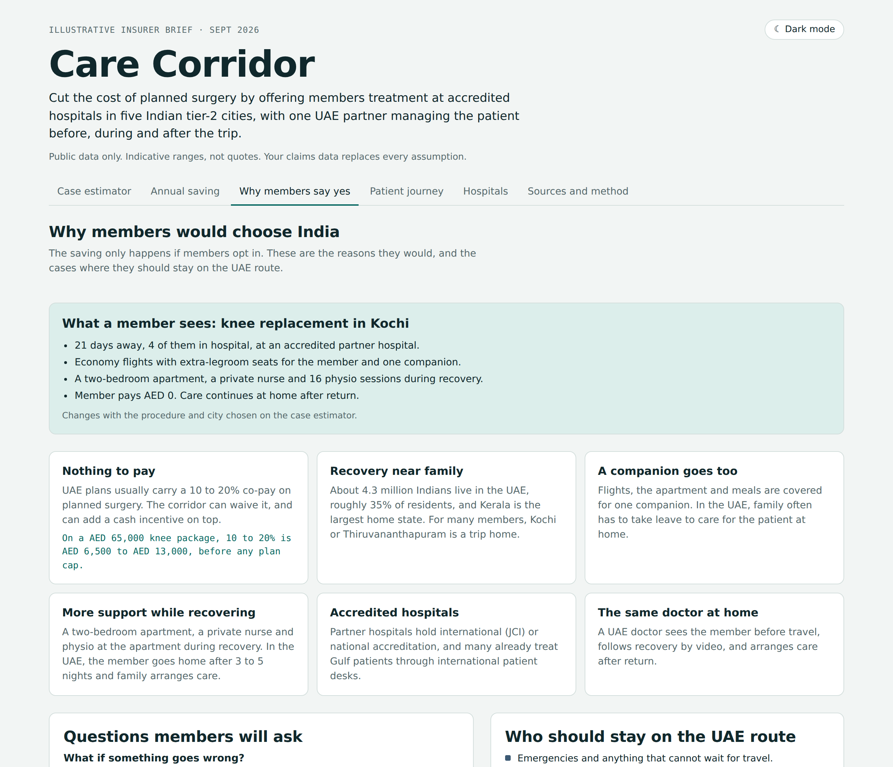

# Care Corridor

**What does a UAE insurer save when planned surgery moves to accredited hospitals in India's tier-2 cities, with a UAE virtual care provider managing the patient before, during and after the trip?**

Care Corridor is a live model that answers that question per procedure, per city and per insurer. It comes in two views built from one source file: one for the care provider deciding whether to launch the service, and one for the insurer deciding whether to buy it.



## Who this is for

- **Insurers and employers in the GCC** deciding whether a planned-surgery travel benefit is worth offering, and for which procedures. Enter your own paid rates and case counts, and the model tells you where the saving is real and where it is not.
- **Care providers and medical travel coordinators** sizing a GCC-to-India line: saving per case, revenue per case, and which procedures to lead with.
- **UAE residents paying for surgery themselves** who want the full cost of a trip, not just the hospital quote. Flights, a companion, the recovery stay, a nurse and physio are all counted. This is a cost guide, not medical advice.
- **Anyone modelling another medical travel route**, such as the UAE to Turkey or Thailand. The prices, stays, hospitals and cities live in one place, so swapping in another destination is a data change, not a rebuild.

## Reuse the data

The research is also published as plain spreadsheets in [`data/`](data), so it can be used without the page:

| File | What is in it |
|---|---|
| `procedures.csv` | UAE and India price ranges, hospital and in-country days, rehab visits and fit-to-fly guidance for 7 procedures |
| `hospitals.csv` | 21 hospitals in 5 cities, with accreditation, whether it was confirmed, known strengths and Gulf links |
| `cities.csv` | Airfares from Dubai, why each city was chosen, and what to watch out for |
| `sources.csv` | Every source behind the numbers, with links |

Prices and accreditations change. Corrections are welcome as issues, with a source link.

## Why this exists

UAE residents already travel to India for surgery, mostly on their own, paying up front and arranging everything themselves. Coordinators such as Vaidam and Lyfboat sell the trip but hand the patient over at the airport. A UAE provider that already holds insurer contracts could own the whole journey: the consult before travel, recovery oversight in India, and rehab at home after return. The open question was whether the numbers work once everything is counted fairly.

## The two views

| | Provider view (`index.html`) | Insurer view (`insurers.html`) |
|---|---|---|
| Job | Should we build this line? | Should we buy it? |
| Headline | Provider revenue per case and per year | Saving per case, saving as a share of spend |
| Fee | Visible and adjustable (share of saving, or flat) | Folded into one "managed care" line |
| Extra tab | | Why members would opt in, and who should not |

Both share the same estimator, hospital directory, patient journey and sources, so the numbers always match.

## How the model works

For each case:

```
UAE cost    = surgery package price + rehab at home after discharge

India cost  = hospital package (international or Indian-patient price)
            + flights for patient and companion
            + recovery apartment, private nurse, meals, transfers, visas
            + specialist physio during recovery in India
            + home visits and teleconsults after return
            + 90-day digital recovery programme (heart and weight-loss cases)
            + provider fee (default 20% of the saving, minimum AED 3,000)

Saving      = UAE cost - India cost
```

Everything is adjustable on the page: procedure, city, hospital price point, UAE price paid, days in India, a complication buffer, unit costs, the fee, a cash incentive for the member, and an insurer's yearly case volumes and opt-in rate.

## Decisions that shaped it

The first version overstated the case. These are the corrections made during review, and why.

1. **Like-for-like rehab.** Version one counted rehab after discharge only on the India side. In the UAE the insurer pays for the same physio and nursing at home, so it is now counted on both sides.
2. **Most of the India stay is not in hospital.** A knee case is 21 days in India but only 4 in hospital. The rest is in an apartment at about AED 410 a day, all in.
3. **Retail prices on both sides.** UAE figures are package and guide prices, not negotiated insurer rates, which are not public. The UAE price is a slider so a real paid rate can replace it. On the India side, listings show foreigners paying about 50% more than Indian patients, so a switch moves India to the Indian-patient price.
4. **Fit to fly sets the stay, and the stay sets the economics.** UK guidance suggests 6 weeks before flying after joint replacement, against about 10 days after heart surgery. Heart surgery clears fastest and saves the most, so it leads the pitch. Joint replacement carries a warning.
5. **Tier-2 cities, filtered by accreditation.** Kochi, Thiruvananthapuram, Coimbatore, Ahmedabad and Jaipur. Jaipur replaced Mangaluru because it has three JCI-accredited hospitals against none confirmed. Unconfirmed accreditations are flagged in amber.
6. **The comfort extras were trimmed.** Business class, a car on call and generous meal budgets came out. Economy with extra-legroom seats is the default, and business class is kept only for the premium price point, where it costs the insurer about AED 2,600 per case.
7. **The fee follows the value.** A flat AED 3,000 undersold cases that save AED 80,000 or more. The fee is now a share of the saving, so the provider earns most where it saves most.
8. **Weight-loss surgery is left out of the pitch.** At current prices it roughly breaks even.

## What it shows

Default settings: Kochi, mid-price hospital, international prices, UAE retail package prices.

| Procedure | UAE cost incl. rehab | India cost | Insurer saves |
|---|---|---|---|
| Heart valve replacement | AED 154,900 | AED 65,600 | AED 89,300 |
| Heart bypass | AED 134,900 | AED 54,400 | AED 80,500 |
| Spinal fusion | AED 86,700 | AED 47,200 | AED 39,500 |
| Hip replacement | AED 81,700 | AED 43,200 | AED 38,500 |
| Robotic prostatectomy | AED 81,400 | AED 45,500 | AED 35,900 |
| Knee replacement | AED 72,400 | AED 38,700 | AED 33,600 |
| Sleeve gastrectomy | AED 35,700 | AED 30,200 | AED 5,500 |

Insurers pay less than retail in the UAE, so real savings will be lower than shown. Negotiated bulk rates in India push the other way.



## Limits

- Prices are public ranges and labelled estimates, not hospital quotes.
- No Saudi baselines, transplants or cancer care beyond prostatectomy in v1.
- The provider's own prices (fee, visits, digital programme) are placeholders.
- Fit-to-fly timings quote public guidance. The operating surgeon decides.

## Run it

No build tools or dependencies are needed. Open `index.html` or `insurers.html` in a browser.

To change the model, edit the data at the top of the script in `src/care-corridor.html` (`PROCS`, `CITIES`, `HOSP`, `SOURCES`) and run:

```
python3 build.py
```

## Sources

Every figure links to its source in the page's "Sources and method" tab: UAE price guides and hospital packages, Indian hospital and aggregator price listings, UK Civil Aviation Authority fit-to-fly guidance, hospital accreditation records and Embassy of India population data.

---

Built with Claude Code, September 2026. Hospital names are real and taken from public sources. The provider is generic.
